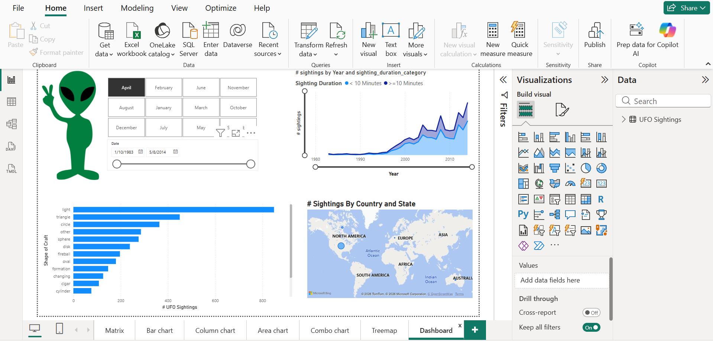

# UFO Sightings: Power BI Dashboard

An interactive Power BI report exploring UFO sighting records by shape, duration, location and time.

## Project Overview
This report has seven pages: one page per visual type (matrix, bar, column, area, combo, treemap) and a combined, interactive **Dashboard** page with a map, charts and slicers.

## Tools Used
Power BI Desktop: data model, DAX measures, matrix, clustered bar, clustered column, stacked area, combo (line and column), treemap, map, slicers.

## Measures and Fields
- `# sightings`: number of sightings
- `% hour-plus sightings`: share of sightings lasting an hour or more
- `avg sighting duration (minutes)`
- Dimensions: `shape`, `sighting_duration_category`, `city`, `state`, `country_name`, `Year`, `Month Name`, `Day Name`, `Date`

## Report Pages
| Page | Visual | What it shows |
|---|---|---|
| Matrix | 3 matrices | Sightings by shape and duration category; average duration by country and city; hour-plus share by year |
| Bar chart | Clustered bar | Sightings and hour-plus share by shape |
| Column chart | Clustered column | Hour-plus share by weekday and country |
| Area chart | Stacked area | Sightings over time by duration category |
| Combo chart | Line and column | Sightings against average duration by shape |
| Treemap | Treemap | Sightings by month and duration category |
| Dashboard | Map, area, bar, slicers | Combined interactive view, filterable by date and month |

## Key Findings
> Read from the Dashboard page with the month slicer set to April and dates from 1/10/1983 to 5/8/2014.

- **Shape:** "light" is the most reported shape (roughly 850 sightings), followed by triangle and circle. Cylinder and cigar are the least common.
- **Trend:** Sightings stay low until the 1990s, then rise sharply, reaching their highest levels around the 2010s.
- **Location:** On the map, sightings are concentrated in North America.
- **Duration:** The area chart splits sightings into under 10 minutes and 10 minutes or more.

## Dashboard Preview

## How to Open
Download `UFO_Sightings_Dashboard.pbix` and open it in Power BI Desktop (free for Windows).

## Author
**Olumide Goodness**
